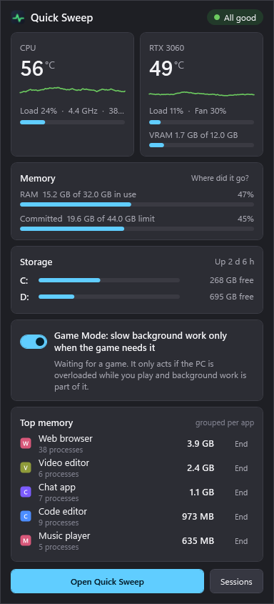
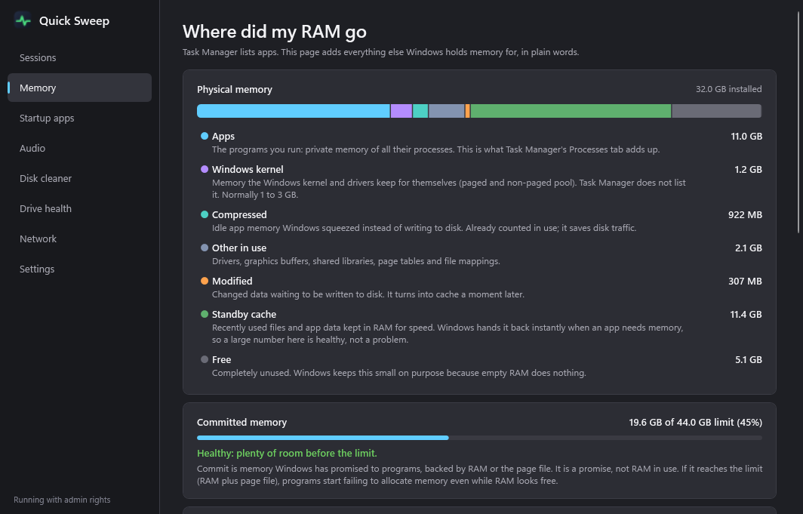
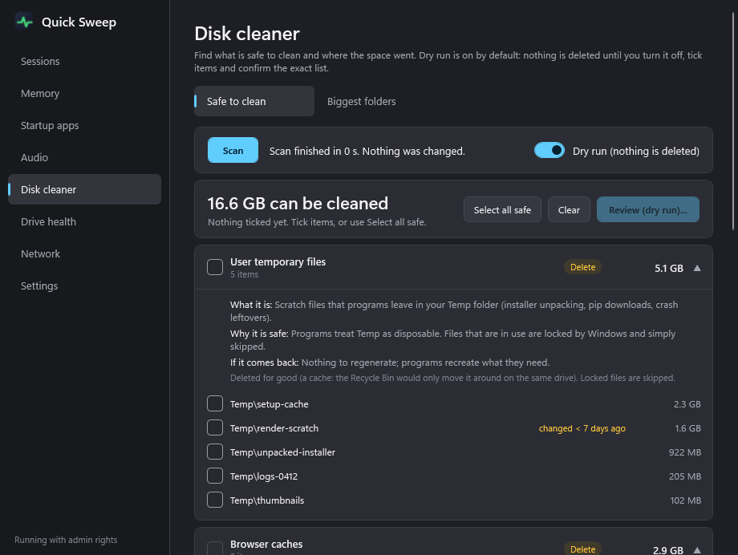

# Quick Sweep

A small Windows tray utility that answers one question without opening anything: **"is my PC OK right now, and was it OK during that game?"**

Task Manager does not show CPU temperature, hides where memory really goes and says nothing after a game ends. Quick Sweep puts the CPU and GPU temperature as numbers on the tray icon, opens a compact panel when you click it, notices when a game is running and writes a short health summary when the game closes. It can also slow down background work (video encodes, builds, renders) while a game is short on CPU, GPU or RAM, and it has a careful disk cleaner.

It is written in C# on .NET 10 with WPF (no Electron, no web view). On the developer's PC it idles at about 12 MB of private memory and about 0.2 % of one CPU core.


| Flyout | Where did my RAM go | Disk cleaner |
|---|---|---|
|  |  |  |

More pictures in [`docs/screenshots`](docs/screenshots): sessions, startup apps, audio, biggest folders (treemap), drive health, network, settings, and the tray icon at 16 to 32 px. All pictures were made with `--shots --demo`, which fills every page with sample data instead of real readings.

## What it does

**Tray icon and flyout**
- CPU temperature (top) and GPU temperature (bottom) drawn as numbers on the icon, coloured when warm or hot.
- One click opens: CPU temperature and load, GPU temperature, load, VRAM and fan, RAM used and committed, free space on every fixed drive, uptime, and the five biggest memory users **grouped per app** (all browser processes are one row), each with a confirmed "End".
- It closes on click-away. The window is created once and kept hidden, so it opens instantly.

**Game awareness**
- A game is detected when a program from a Steam, Epic, GOG, Riot, Ubisoft, EA or Xbox library folder (or a folder you add) shows a real window, or when an unknown program holds the foreground in true fullscreen while the GPU is busy. Nothing is special-cased for particular games.
- **Game Mode** slows background work only when the game needs the room. It is on by default and has one switch in the flyout and in Settings. While a game runs it watches the load; nothing is touched until the PC is overloaded **and** background work is part of it. Then it lowers that work to Idle (or Below Normal) priority. It never stops or kills anything, and never touches the game or the program you are looking at.
  - *Background work* is a list you can edit in Settings. The defaults are encoders (ffmpeg, HandBrake, x264, x265, ImageMagick), 3D and slicer tools (Blender, PrusaSlicer, Bambu Studio, Orca Slicer, Cura), build tools (MSBuild, CMake, Ninja, Cargo, rustc), headless Chrome, Chromium and Edge, busy script runtimes (node, bun, deno, python), and everything an AI coding agent such as Claude Code or Codex started (its builds, renders and browsers).
  - *Overloaded* means one of these limits is crossed for most of the last 12 seconds (all editable in Settings):

    | Signal | Default limit | Relieved by |
    |---|---|---|
    | Total CPU load | 85 % or more | lowering the CPU priority of background work |
    | GPU load | 95 % or more | lowering the GPU scheduling class of background processes that use the GPU (and their CPU priority) |
    | Available RAM | under 2 GB, or commit at 93 % with under 4 GB left | memory priority "very low", so Windows trims those pages first |
    | Game threads waiting for a core | 25 % or more of the game's runnable threads (with total CPU over 55 %) | CPU priority. This is a stand-in for frame time; real frame times need ETW or PresentMon, which Quick Sweep does not run. |

  - *Contributing* means the background work adds up to at least 5 % of the CPU (or GPU), or 500 MB of RAM for the RAM case. If nothing contributes, nothing is slowed.
  - Everything is put back when the game closes, or when the load has stayed calm for 90 seconds, followed by a 120 second cooldown so a borderline load cannot flap. If Quick Sweep is killed mid-game, the list is stored and restored at the next start.
  - Every action is written into that game's session summary, and there is at most one quiet notification per game. No sounds.
- **Game flag file.** While a game runs, `%ProgramData%\QuickSweep\public\gaming.json` exists (a plain, non-elevated run uses `%LOCALAPPDATA%\QuickSweep\public\gaming.json`): `{"game": "Some Game", "exe": "SomeGame.exe", "since": "2026-10-11T21:14:03+03:00", "pid": 4242}`. It is deleted when the game closes, at start-up and on exit, so it is never stale. Other programs can look for it and put off heavy work, for example in PowerShell: `if (Test-Path "$env:ProgramData\QuickSweep\public\gaming.json") { "wait" }`.
- **After-game summary** (one entry per game, the last 20 are shown on the Sessions page): duration, peak and average CPU and GPU temperature, peak loads, peak RAM and VRAM, whether anything throttled, router and internet ping spikes, and what Game Mode did. Sessions under a minute are ignored.

**Alerts, only when something is really wrong** (never a sound, never repeated within three hours): CPU over 90 °C or GPU over 83 °C for a sustained stretch, low free space on C:, an app whose memory climbs steadily (a leak), Windows kernel memory ballooning, a drive that is failing or getting worse. During a game they are held back and shown after it ends.

**Memory explained**: physical memory split into apps, Windows kernel, compressed, other, modified, standby cache and free, each with a plain-words description; committed memory against the commit limit; the biggest kernel pool users by tag (needs admin).

**Startup apps**: every Run-key and Startup-folder entry with its measured RAM cost and an on/off switch. It uses the same reversible StartupApproved keys as Task Manager's Startup tab; nothing is deleted.

**Audio**: switch the default output device and set per-app mixer levels. An app (or the device) sitting well below 100 % in the Windows mixer is flagged, with a "Set to 100 %" button.

**Disk cleaner**: a "safe to clean" list with sizes per category, and a sortable folder tree with a treemap. See the safety rules below.

**Drive health**: SMART status, wear, temperature, reallocated, pending and uncorrectable sectors, power-on time and written TB for SATA drives, and a warning when a drive gets worse compared with its remembered baseline. NVMe and USB-bridged drives are listed, but their SMART is not read in this version.

**Network**: one ICMP packet every 3 seconds to your default gateway and to 1.1.1.1, with latency, loss, spikes and a verdict: your network, the internet, or neither.

## Install

You need Windows 10 or Windows 11, 64-bit. Quick Sweep is developed and tested on Windows 11; Windows 10 should work but has had less testing.

1. Download the latest zip from the [Releases](../../releases) page and extract it anywhere.
2. Double-click **Install Quick Sweep.bat** and click **Yes** in the Windows permission prompt.
3. Answer the questions in the window that opens (press Enter to accept the defaults). When it is done, Quick Sweep is in the tray; Windows may put it in the overflow arrow first, so drag it onto the taskbar if you want it visible.

Windows SmartScreen may say "Windows protected your PC" the first time, because the program is not code-signed (a certificate costs money). The source is in this repository and the release zip is built by the workflow in `.github/workflows`, so you can check what you run or build it yourself.

**Why it asks for administrator rights.** CPU temperature lives in model-specific registers and PCI configuration space that normal programs cannot read, and drive SMART data needs raw disk access. Both need admin. So the installer registers a Windows scheduled task that starts Quick Sweep at logon with the highest privileges, hidden, with no permission prompt each time. Without admin, Quick Sweep still works, but the CPU temperature and drive health show as unavailable.

**What the installer does:**
1. Copies the program to `C:\Program Files\QuickSweep` (only administrators can change it, because the program runs elevated) and creates the data folder `C:\ProgramData\QuickSweep` (users can read it, only administrators and the system can write).
2. Installs the **.NET 10 Desktop Runtime** from Microsoft through `winget` if it is missing, after asking.
3. Installs the **PawnIO** driver through `winget` (`namazso.PawnIO`) if it is missing, after asking. Skip it with `install.ps1 -SkipSensorDriver`; the CPU temperature then shows as unavailable.
4. Registers the scheduled task `QuickSweep` and adds a Start-menu shortcut.
5. Starts Quick Sweep.

**About the PawnIO driver, honestly.** Reading CPU temperature needs code that runs in the Windows kernel, so a signed driver is unavoidable. [LibreHardwareMonitor](https://github.com/LibreHardwareMonitor/LibreHardwareMonitor), which Quick Sweep uses for the CPU, switched in 2025 from the old WinRing0 driver (which Windows Defender flags) to [PawnIO](https://pawnio.eu). PawnIO does not expose raw port and register access to every program; it loads small signed modules that do one job each. It is a third-party project that Quick Sweep does not control. It is installed only if you agree, it is not part of this repository, and `uninstall.ps1` removes it only if the installer put it there. The GPU is read through NVIDIA's NVML library (part of the NVIDIA display driver), which needs no driver of its own.

## Privacy

- **No telemetry, no accounts, no update checks, no analytics.** Quick Sweep never uploads anything.
- The only network traffic is one small ping every 3 seconds to your default gateway and to `1.1.1.1`. Switch it off in Settings; Game Mode, the cleaner and everything else keep working.
- Everything it records (settings, game sessions, logs) stays in `C:\ProgramData\QuickSweep` on your PC. You can open that folder from Settings, and delete it any time.
- The installer downloads only through `winget`, from Microsoft's and the PawnIO publisher's packages, and only after asking.

## The disk cleaner's safety rules

The cleaner is built so that a mistake costs nothing.

- **Dry run is the default.** The switch stays on until you turn it off. A dry run does everything (measuring, safety checks, the confirmation list, the log) except the final delete.
- **Nothing is deleted unless you tick it and confirm.** The confirmation dialog lists the exact paths, sizes and how each is removed, and shows the total. Anything on the system drive needs a typed `DELETE`.
- **Recycle Bin where it makes sense.** Folders you add yourself go to the Recycle Bin. Pure caches (temp files, shader caches, package-manager caches) are deleted permanently, because moving them to the bin of the same drive would not free space. A switch in the dialog sends everything to the bin instead.
- **Hard protection list**, checked when an item is found and again right before it is touched, and also against everything inside a folder: the Windows folder (except `Temp`), `Program Files`, `ProgramData` (except named cache folders: NVIDIA downloads, Windows error reports), your Documents, Desktop, Pictures, Videos, Music, Downloads and OneDrive folders, every `.git` folder, drive roots and whole-profile folders, UNC paths, short 8.3 names, paths with `..`, and any folder you add under **Protected folders** in Settings. A folder that contains a protected folder is refused as a whole.
- **Your folders are cleaned with your own rights, not with admin rights.** Quick Sweep normally runs elevated, but it does not delete in a place a normal program can write to (your Temp, browser and package caches, extra folders you added). For those it starts a small helper process with your own, non-elevated token, which deletes and reports back; if the helper cannot be started, nothing is deleted. A program running as you could otherwise swap a folder for a junction between the safety check and the delete and make an elevated delete land somewhere else. The elevated side deletes only inside a short fixed list of system locations that need admin rights (`C:\Windows\Temp`, NVIDIA's download and shader-cache folders in `ProgramData`, Windows error reports), always permanently, and even there it deletes through handles: the parent folder is opened and verified once, every entry is opened relative to its parent and removed as the very object that was opened, and a junction or symlink is removed as a link and never entered.
- **Cache folders named by environment variables** (`PIP_CACHE_DIR`, `UV_CACHE_DIR`, `NUGET_PACKAGES`, `npm_config_cache`) are only offered when they are plain folders owned by you (or by Administrators) outside Windows, Program Files and ProgramData; anything else is ignored and noted in the log. Your Temp folder and profile come from Windows' profile records, not from the `TEMP` or `USERPROFILE` variables.
- **Never follows junctions or symlinks.** Walking, measuring and deleting stop at a link. A link inside a tree is removed as a link and its target is untouched; a path below a link is refused.
- **Flags recent changes.** Anything modified in the last 7 days is marked and never ticked automatically.
- **Windows-managed data** (Windows Update leftovers, `Windows.old`, setup logs) is only measured. The app offers to open Windows' own Disk Cleanup for them.
- **Every action is logged** in `deletions.log` in the data folder (time, mode, result, bytes, path).

Built-in categories: user and Windows temp files, browser caches, package-manager caches (npm, pnpm, Yarn, pip, uv, NuGet, Gradle), GPU shader caches, NVIDIA installer leftovers, and crash dumps and error reports. Each one says what it is, why it is safe and what regenerating costs. **Extra folders to scan** (empty by default) lets you add your own, for example build output of your projects; see below.

## Settings

Most things are in the Settings page. The file behind it is `settings.json` in the data folder; **Export settings** and **Import settings** in the Settings page copy it to and from a file you choose (an import changes only the keys that are in the file). The useful keys:

```json
{
  "ExtraGameFolders": ["D:\\Games"],
  "BackgroundProcesses": ["ffmpeg", "blender", "mytool"],
  "ScriptRuntimes": ["node", "python"],
  "AgentApps": ["claude", "codex"],
  "ExtraScanFolders": [
    { "Pattern": "D:\\Projects\\*\\build", "Label": "Build output", "IdleDays": 0 },
    { "Pattern": "D:\\Projects\\**\\node_modules", "Label": "node_modules", "IdleDays": 30 }
  ],
  "ProtectedFolders": ["D:\\Important", "D:\\Projects\\**\\src"],
  "CpuAlertC": 90, "GpuAlertC": 83, "LowSpaceGb": 10
}
```

In a folder pattern, `*` stands for part of one folder name, `**` for any number of folders, and a few well-known variables work (`%LOCALAPPDATA%`, `%APPDATA%`, `%USERPROFILE%`, `%TEMP%`, `%ProgramData%`, `%SystemRoot%`, `%ProgramFiles%`); they are filled in from Windows' own records, not from the environment, so a changed variable cannot point the cleaner somewhere else. `IdleDays` offers a folder only when nothing in it has changed for that many days. Matches are offered as separate items, go to the Recycle Bin, and the protection list still wins.

## Uninstall

Open PowerShell as administrator in the extracted folder and run `.\uninstall.ps1`. It removes the scheduled task, the shortcut, the program files and (unless you pass `-KeepData`) the data folder, and it removes the PawnIO driver only if `install.ps1` installed it (`-KeepSensorDriver` leaves it).

## Build from source

You need the .NET 10 SDK on Windows.

```powershell
dotnet build QuickSweep.slnx -c Release
dotnet test tests/QuickSweep.Tests -c Release --filter "Needs!=NonAdmin"   # the tests that do not depend on the account being a non-admin
.\build.ps1          # publishes the app to .\dist
.\install.ps1        # from an elevated PowerShell: installs what is in .\dist
```

The tests build their sandboxes under `%QUICKSWEEP_TEST_TMP%` (default: the temp folder). They include real NTFS junctions to prove that a link's target survives. `tests/e2e-security.ps1` runs an isolated `--dev` instance with a scratch data folder. `tests/e2e-game.ps1` starts a stand-in game and refuses to run unless you pass `-IUnderstandThisSlowsRealBackgroundWork`, because Game Mode would slow every real encoder, script and browser while it runs; use it on an idle test PC only.

Developer switches of the executable: `--shots=<dir>` renders every page to PNG without showing a window, add `--demo` to fill them with sample data (add `--gif` for the flyout animation frames), `--dump=<file>` writes the live readings, `--clean-scan=<file>` runs the cleaner measurement read-only, `--dev` starts a separate instance next to an installed one, `--data=<folder>` gives that instance its own data folder (honored only together with `--dev` and never by an elevated process).

## Limits

- The GPU numbers need an NVIDIA GPU. NVMe SMART is not read.
- The CPU "throttled" flag is a heuristic (package temperature at the 95 °C level); the GPU flag comes from the driver's throttle reasons.
- Game detection is heuristic. If a launcher or tool is mistaken for a game, switch Game Mode off in the flyout (it only ever lowers priorities, and restores them).
- Windows balloon notifications have no buttons, so Game Mode has no action in its notification; its switch is in the flyout and Settings.

## For the security-minded

The installed instance runs elevated, so it never trusts a place a normal process can write to. Its state is in `C:\ProgramData\QuickSweep` (SYSTEM and Administrators full control, users read-only); the app re-checks owner, permissions and links at every start, refuses the folder if it is wrong, and opens every file there without following links and verifies it through the handle. The only user-writable input is a tiny request file (`open.txt` in `%LOCALAPPDATA%\QuickSweep`) that a launcher leaves next to a named event: it is capped at 64 bytes and may only say "open the main window", "toggle the flyout" or name one known page; anything else is ignored and logged, and there is no way to name a path or a command. The elevated instance also ignores `QUICKSWEEP_DATA` and `--data`, so nothing a user-level program sets can move its state folder, and it re-checks that folder at every start. See [SECURITY.md](SECURITY.md) to report a problem.

## License

[MIT](LICENSE). Bundled libraries and their licenses are listed in [THIRD-PARTY-NOTICES.md](THIRD-PARTY-NOTICES.md).
